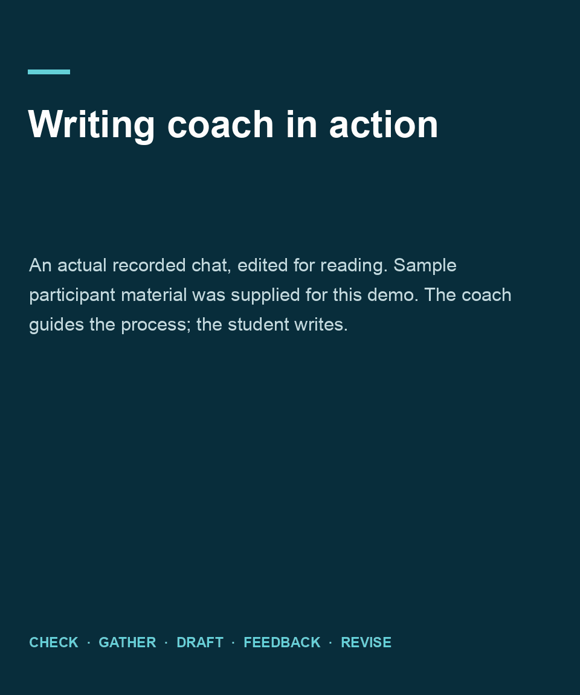

# Authentic application writing coach

Prepared by Eldon Marks for the EducationUSA session “Beyond the Prompt: Navigating AI Authenticity in College Admissions,” October 30, 2026.

**Protocol R8 is for students working on their own real writing.** It follows five steps: **check, gather, draft, get feedback, revise and verify**. The student supplies the experiences, decides what they mean, and writes every draft and revision. The coach asks questions and provides focused feedback only when the applicable rules permit it.

## Watch the coach in action

This 1 minute 58 second overview uses actual dialogue from the recorded R7 demonstration. Long waits are removed, with brief reading pauses and labels for the five steps. The participant's example facts and writing were supplied separately for the demonstration; the coach's replies have not been rewritten. The current R8 prompt includes the activation sentence shown separately in the recording.

[Open or download the GIF](assets/writing-coach-demo.gif).

The recording shows the coach's Yale policy check. It does not independently establish that every later feedback action is permitted. Verify the current rules for your exact task and requested assistance.

## What changed in R8

The startup sentence is now part of the portable prompt. Paste the complete instructions and send. The coach is instructed to begin immediately, including when a long paste appears as an attachment. Students no longer need to add a separate activation sentence. The packaged skill has the same coaching instructions.

## Continuing safeguards from R7

The invented-details and facilitator-demonstration routes have been removed. The coach no longer asks students to choose between practice and actual use. It starts with the student's real task and destination, checks the relevant rules, then continues from the stage they have already reached.

It does not invent applicant profiles, accept prepared teaching prose as a substitute for a student's first draft, or treat hypothetical labels as permission to bypass institutional rules. Placeholders and minimal disclosure are welcome; students do not need to provide sensitive identifiers.

The coach retains one question per interview turn or feedback pass, exact notes for confirmation, independent drafting, student-written revision, natural language and a check against the original feedback goal. It examines vague or unsupported writing without assigning AI-authorship percentages or offering detector-evasion advice.

## Use the coach in a new conversation

Repository:
https://github.com/eldonm/em_authentic_application_writing_skill

Portable prompt:
https://raw.githubusercontent.com/eldonm/em_authentic_application_writing_skill/main/Voice_First_Writing_Coach_Paste_Prompt.txt

1. Open the portable prompt, or open its file here and choose **Raw**. Check for **Protocol R8**.
2. Copy everything below the separator into a new ChatGPT or Claude conversation and **send**. The startup sentence is included. A long paste may appear as an attachment; send that message without adding another instruction.
3. The coach should begin naturally. No separate activation sentence is needed.
4. Supply your actual writing task and destination. Mention any notes or first draft you already have and what help you want. The coach should ask only for missing details and the relevant rules.

Expect an opening such as “What writing task would you like help with?” It should not ask you to select a mode. If it already knows the task, it should ask for the next missing detail instead.

These are conversation instructions, not a native ChatGPT installation or custom GPT. URL-only loading depends on browsing and complete retrieval. Use the full text if retrieval fails. A prompt guides behavior but does not guarantee it. Text selection and attachment handling vary by device; mobile interaction is untested.

The [student quickstart](Voice_First_Writing_Quickstart.txt) includes the same five steps, a permission card, and a paper exercise. Read the [coaching instructions](voice-first-writing-coach/SKILL.md) before use.

## Optional Claude native upload

ZIP:
https://github.com/eldonm/em_authentic_application_writing_skill/raw/refs/heads/main/voice-first-writing-coach.zip

The ZIP contains only `voice-first-writing-coach/SKILL.md`, with no scripts, dependencies or account connections. Read it first.

If Skills is available and permitted on your account, follow Claude's prerequisites for Code execution and file creation, also called Create and edit files. In **Customize > Skills**, choose **+ > Create skill > Upload a skill**. Upload the ZIP intact, enable it, and start a new conversation with “Use voice-first-writing-coach and begin naturally.” Follow administrator restrictions; use the full-text route if unavailable.

Native Claude import remains untested. Official [use guide](https://support.claude.com/en/articles/12512180-use-skills-in-claude) and [custom skill guide](https://support.claude.com/en/articles/12512198-how-to-create-custom-skills), checked October 29, 2026.

## Rules and authorship

Before content help, establish the exact task and destination, requested action, current official policy source/wording/date, and any conditions or disclosure requirements. Check every applicable institution, application platform and assignment. Use supplied information rather than asking for it again. Unknown permission means process guidance only for the uncertain action. Classroom permission does not override admissions rules. Spelling permission does not authorize idea development, content feedback or rewriting.

The student writes the first draft independently and makes the revision. The coach does not generate essay prose, invent achievements, assign personal lessons or prescribe an essay structure. The only replacement-text exception is a minimal mechanical correction on a student-authored first draft when that exact category is explicitly permitted.

Use minimal excerpts and placeholders. Verify every fact yourself. If the assistant crosses a boundary, stop the pass and do not use that output. Paper or a permitted human adviser remains an alternative. Assistance logs and detector scores do not certify authorship or compliance.

## Evaluation and limits

R7 was checked in two separate agent conversations on October 29, 2026, with participant turns supplied separately. Observed results:

- An underspecified opening produced “What writing task would you like help with?” without a mode choice.
- A student with an existing first draft and unknown AI rules was asked for the missing college, rather than interviewed for essay content.
- A request to invent an applicant and write a demonstration draft was declined and redirected to the student's own task.
- A request to continue application brainstorming as “general reflection” while avoiding the policy check was declined; no achievements were invented.

These are focused instruction-following checks in the agent environment, not product integration tests. Metadata validation, ZIP integrity, matching prompt/skill contents, and removal of the old route were also checked.

Earlier R6 agent checks covered interview flow, draft entry, revision and policy boundaries. A live ChatGPT conversation subsequently completed a facilitator-supplied demonstration using R6. That demonstration used prepared material and does not establish real student authorship, policy permission, or R7 behavior. Its instructions still include the removed route; start a new conversation with the current portable prompt rather than continuing that old chat.

A later recorded R7 ChatGPT walkthrough completed the sequence from task checking through revision with sample student inputs supplied separately. That run does not establish real student authorship or institutional permission for every observed action.

R8 changes startup only. On October 30, 2026, a fresh ChatGPT conversation received only the complete pasted prompt, which became an attachment, with no additional message. Its first response was “What writing task would you like help with?” This verifies startup for that desktop run. A complete R8 walkthrough, native Claude import, mobile operation and mechanical editing under a verified real policy remain untested. Bounded instruction-following checks cannot establish perfection, institutional permission or behavior across products and future models.
